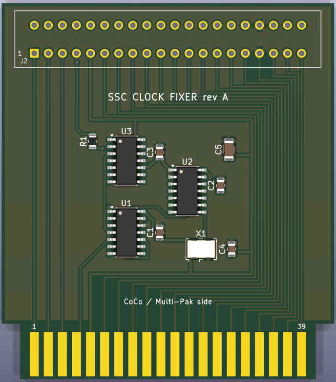

# Rev A PCB

KiCad 10 board for the rev A interposer in [DESIGN.md](../DESIGN.md).
[gen_pcb.py](gen_pcb.py) generates the board from scratch: outline, footprints, nets, routing and GND pour.

```
/Applications/KiCad/KiCad.app/Contents/Frameworks/Python.framework/Versions/Current/bin/python3 pcb/gen_pcb.py
/Applications/KiCad/KiCad.app/Contents/MacOS/kicad-cli pcb drc --severity-all pcb/ssc-fixer.kicad_pcb
```

DRC result: 0 violations, 0 unconnected items.



## Layout

* **J1**: 40 gold fingers at 0.1" pitch on a 53.3 mm (2.1") tab. Odd pins are on the top (F.Cu) and even pins on the bottom, with pin 1 at the left when you look at the top.
* **J2**: a 2x20 0.1" through-hole card-edge socket. J2-n sits directly above J1-n.
* **Pass-through:** each odd pin has its own trace on F.Cu and each even pin has one on B.Cu. Pins 8–40 squeeze into a 0.6 mm bus on the right, which leaves a parts window in the middle of the board.
* **Logic:** in that window. It taps E (pin 6) and +5 V (pin 9) from their traces, takes Q straight from finger J1-7 and drives J2-7 through R1. GND comes from J2-34 over the top of the socket. The board has a GND pour on both layers.
* The script's small grid maze router does the logic routing.

## Changes from DESIGN.md

* **SMD logic instead of DIP:** U1–U3 are SOIC-14, X1 is a 5×3.2 mm 4-pin SMD oscillator (pin 1 = enable, tied high), and R/C are 0805 (C5 is 1206). Through-hole pins would collide with the pass-through traces.
* **No schematic:** the nets are assigned directly in the PCB and follow the DESIGN.md netlist.

## Check before ordering

1. **Finger side and pin 1.** The board assumes odd CoCo pins are on the component side, with pin 1 at the left. Pass-through pins map 1:1 whichever way round this is, but if the assumption is wrong, the logic taps the wrong fingers for E, Q and +5 V.
2. **The J2 footprint is a placeholder:** 2.54 mm pitch, 5.08 mm (0.2") between rows, 1.0 mm drill. Match it to the socket you buy. A through-hole socket also makes the SSC stand at right angles to this board. Check that this fits the CoCo or Multi-Pak.
3. **Finger length and tab width** (8 mm, 53.3 mm). Check them against the CoCo connector. Order hard gold and a 20–45° bevel.
